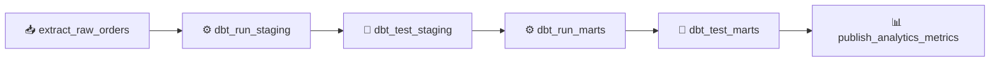

# 🏗️ Airflow dbt Pipeline

[](https://github.com/MSBHOSLE/airflow-dbt-pipeline/actions)
[](https://airflow.apache.org/)
[](https://getdbt.com/)
[](https://www.postgresql.org/)
[](LICENSE)

An enterprise **orchestrated data warehouse transformation pipeline** linking **Apache Airflow** DAG orchestration with **dbt** (data build tool) modeling, testing, and continuous quality checks.

---

## 🏗️ DAG Workflow



---

## ⚡ Highlights

- **Linear DAG Orchestration**: Explicit task dependencies with automated retry policies.
- **dbt Testing & Validation**: Automated uniqueness, not-null, and dimensional consistency checks before publication to production marts.
- **Clean Staging & Dimensional Marts**: Staging views cleansing source raw tables into standardized fact & dimension tables.

---

## 🚀 Running DAG Tests

```bash
python -m unittest discover tests
```

---

## 👤 Author

**Mahesh Sanjayrao Bhosle**
- **GitHub:** [@MSBHOSLE](https://github.com/MSBHOSLE)
- **LinkedIn:** [Mahesh Bhosle](https://linkedin.com/in/mahesh-bhosle-916991198)
- **Email:** msbhosle.2@gmail.com
- **Education:** M.Sc. Data & Computer Science, Heidelberg University

---

## 📄 License

MIT License - see [LICENSE](LICENSE).
